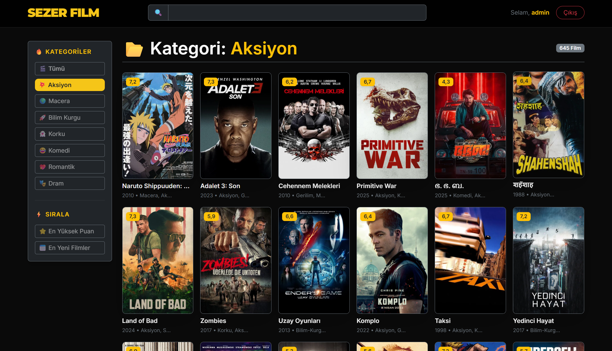
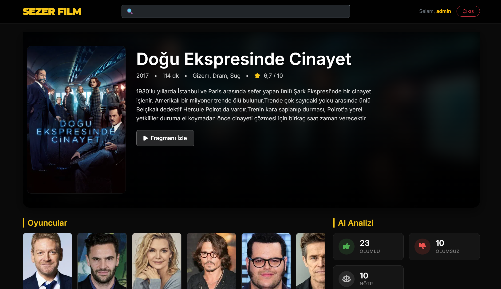
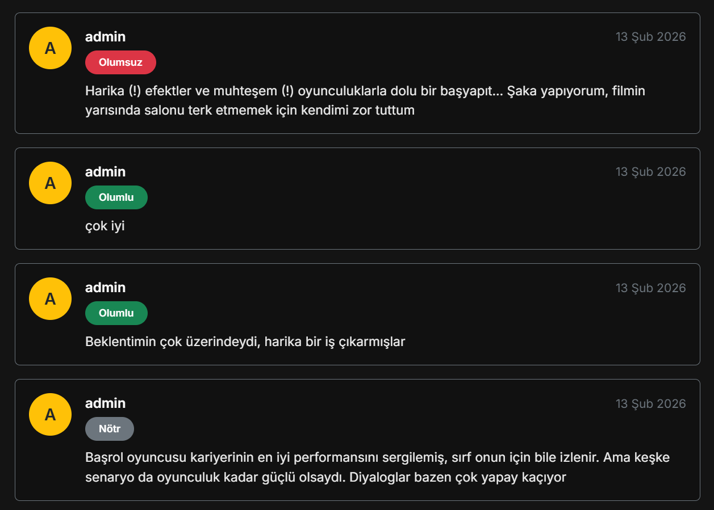
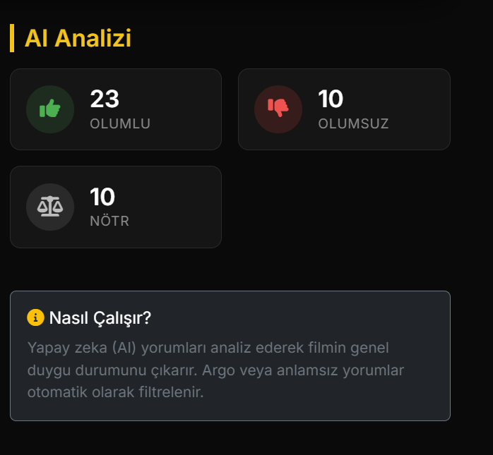
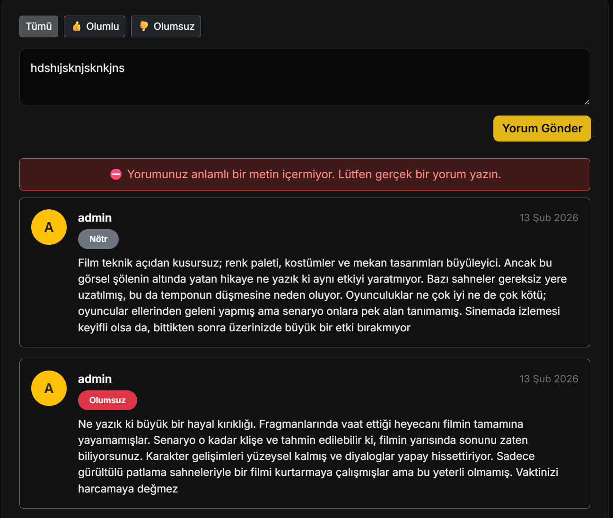
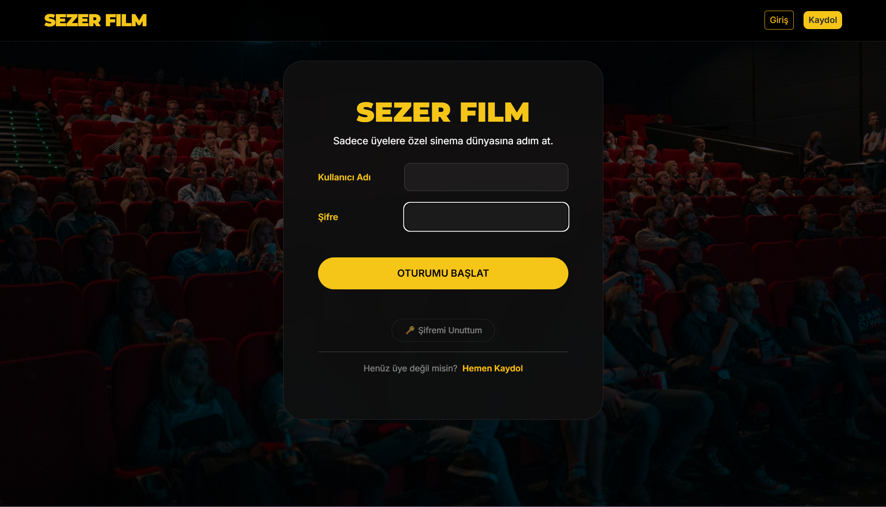
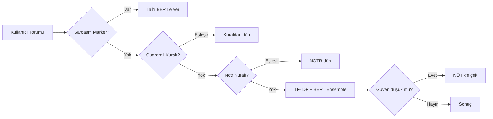

# 🎬 SezerFilm — AI Destekli Türkçe Film İnceleme Platformu

> Türkçe film yorumlarını **fine-tuned BERT + TF-IDF ensemble** ile gerçek zamanlı analiz eden, TMDB API ile zenginleştirilmiş modern bir Django uygulaması.


---

## 🌐 Canlı Demo

🔗 **https://turkish-movie-review-sentiment.onrender.com**

> **⚠ Render Free Tier kısıtlamaları:**
> - 512 MB RAM, paylaşımlı CPU
> - **Cold start ~30–60 sn** (kullanılmayınca uyku moduna girer)
> - **İlk analiz ~10–30 sn** (BERT modeli RAM'e yüklenmesi; sonraki analizler <500 ms)
> - **Ephemeral disk:** her restart'ta DB içeriği sıfırlanır, build'de otomatik yeniden çekilir
>
> 💡 *Tam performans için lokalde çalıştırılması önerilir.*

---

---

## 📸 Uygulama Ekran Görüntüleri

| Netflix Tarzı Ana Sayfa | Film Detay & Fragman | AI Duygu Analizi & Yorumlar |
| :---: | :---: | :---: |
|  |  |  |

| AI Analiz Dashboard (Streamlit) | Spam & Küfür Guardrail | Kullanıcı Girişi |
| :---: | :---: | :---: |
|  |  |  |

---

## ✨ Özellikler

- **🧠 Hibrit duygu analizi** — Fine-tuned BERT + TF-IDF/Logistic Regression + kural tabanlı guardrail'ler
- **🎭 Sarcasm/ironi tespiti** — "şaka yapıyorum, salondan çıktım" gibi cümlelerde iki katmanlı analiz
- **⚖ Belirsizlik yönetimi** — düşük güvenli tahminler otomatik NÖTR'e çekilir
- **🕷 Otomatik veri toplama** — TMDB API ile binlerce film + poster + fragman
- **🔍 Anlık arama** — debounce'lu live-search, Spotify tarzı sonuç dropdown'ı
- **🎨 Modern arayüz** — Netflix tarzı hero carousel, 10+ kategori carousel'ı, dark theme
- **🔒 Güvenlik** — CSRF, XSS koruması, hash'li dependency lock, secret'lar `.env` ile

---

## 🧠 AI Modeli

| Özellik | Değer |
|---|---|
| **Mimari** | Fine-tuned BERT (`dbmdz/bert-base-turkish-cased`) + TF-IDF + Logistic Regression |
| **Sınıflar** | OLUMSUZ · NÖTR · OLUMLU (3-class) |
| **Veri seti** | ~190.000 satırlık temizlenmiş Türkçe film yorumu (Beyazperde + diğer) |
| **Optimizasyon** | Dynamic Quantization (int8) — RAM ~%50 azalır, CPU inference hızlanır |
| **Guardrails** | Küfür, ironi, anlamsız metin, emoji çatışması, fuzzy matching |
| **Versiyon** | `benim_bert_modelim_3cls_v2` |

### Analiz akışı



---

## 🏗 Mimari

**Monolithic Direct Mode** — AI ayrı bir mikroservis olarak değil, Django process'i içinde **lazy-load** edilir. Render Free Tier'ın 512 MB sınırında performans/yönetim dengesi için bu seçim.

```
┌──────────────────────────────────────────────┐
│              Django Web App                   │
│  ┌────────────────────────────────────────┐  │
│  │   filmler/  — Views, Models, Admin     │  │
│  │   ↓                                    │  │
│  │   services/                            │  │
│  │     sentiment_service.py               │  │
│  │     moderation_service.py              │  │
│  │     tmdb_service.py ───→  TMDB API     │  │
│  └────────────┬───────────────────────────┘  │
│               │ (Direct Python call)         │
│  ┌────────────▼───────────────────────────┐  │
│  │   yapay_zeka_servisi/                  │  │
│  │     rules.py          ── Kural setleri │  │
│  │     ensemble_core.py  ── BERT + TFIDF  │  │
│  │     streamlit_app.py  ── Geliştirme UI │  │
│  └────────────────────────────────────────┘  │
└──────────────────────────────────────────────┘
```

---

## 🛠 Lokal Kurulum

### 1. Repo'yu klonla

```bash
git clone https://github.com/erensezer07-gif/turkish-movie-review-sentiment.git
cd turkish-movie-review-sentiment
```

### 2. Sanal ortam + bağımlılıklar

```bash
python -m venv .venv

# Windows:
.venv\Scripts\activate
# macOS/Linux:
source .venv/bin/activate

pip install --upgrade pip setuptools wheel
pip install torch --index-url https://download.pytorch.org/whl/cpu
pip install -r requirements.txt
```

### 3. BERT modelini indir (~400 MB)

```bash
python scripts/download_model.py
```

> Model Google Drive'dan `yapay_zeka_servisi/benim_bert_modelim_3cls_v2/` dizinine iner.

### 4. Ortam değişkenlerini ayarla

`.env.example` dosyasını `.env` olarak kopyala, doldur:

```bash
cp .env.example .env   # Windows: copy .env.example .env
```

Minimum:
```ini
SECRET_KEY=django-insecure-...      # rastgele üret
DEBUG=True
TMDB_API_KEY=<TMDB'den al>
```

### 5. Veritabanı + ilk filmler

```bash
python manage.py migrate
python manage.py film_cek 5        # 5 sayfa × 20 = ~100 film
python manage.py createsuperuser
```

### 6. Sunucuyu başlat

```bash
python manage.py runserver
```

→ http://127.0.0.1:8000

> İlk yorum analizinde BERT belleğe yüklenir (~10-30 sn). Sonraki analizler hızlıdır.

---

## ☁ Render.com Deploy

### 1. Repo'yu push et

```bash
git add .
git commit -m "Production hazır"
git push origin main
```

### 2. Render'da yeni Web Service oluştur

1. [Render Dashboard](https://dashboard.render.com) → **New +** → **Blueprint**
2. GitHub repo'nu seç
3. Render `render.yaml`'i otomatik okur ve servisi oluşturur

### 3. Environment Variables ekle (Dashboard → Environment)

Bunları **Render Dashboard**'da elle gir (kod içinde değil):

| Key | Değer | Açıklama |
|---|---|---|
| `SECRET_KEY` | `python -c "from django.core.management.utils import get_random_secret_key; print(get_random_secret_key())"` çıktısı | Django güvenlik |
| `TMDB_API_KEY` | TMDB v3 API key | Film verisi |
| `DEBUG` | `False` | Production |
| `ALLOWED_HOSTS` | `.onrender.com` (Render otomatik ekler) | — |
| `DISABLE_WARMUP` | `1` | İlk başlatmada OOM'u önler |
| `DJANGO_SUPERUSER_USERNAME` | `admin` *(opsiyonel)* | İlk açılışta admin |
| `DJANGO_SUPERUSER_PASSWORD` | güçlü şifre | |

### 4. Deploy'u tetikle

Push attığın anda Render build başlar:

```
▶ pip + setuptools güncelleniyor
▶ Torch (CPU) kuruluyor
▶ Diğer bağımlılıklar kuruluyor
▶ BERT modeli indiriliyor (Google Drive)
▶ Veritabanı şeması uygulanıyor
▶ Statik dosyalar toplanıyor
✓ Build tamamlandı
```

İlk build ~8-12 dakika sürer (model indirme + torch). Sonraki deploy'lar ~2-3 dakika.

---

## 📦 Bağımlılık Yönetimi

Bağımlılıklar **pip-tools** ile yönetilir:

- `requirements.in` → manuel yazılan üst-seviye paketler
- `requirements.txt` → pip-compile ile üretilen, hash'li, pinned lock dosyası

### Yeni paket eklemek

```bash
# 1. requirements.in'e ekle
echo "yeni-paket" >> requirements.in

# 2. Lock dosyasını yenile
pip-compile --generate-hashes requirements.in -o requirements.txt

# 3. Yerelde uygula
pip-sync   # veya: pip install -r requirements.txt
```

### Sürüm bump

```bash
pip-compile --upgrade requirements.in -o requirements.txt
```

> **⚠ Önemli:** `requirements.txt`'i **elle düzenleme**. Tek istisna: torch satırı zaten kaldırılmıştır; CPU-only torch `render_build.sh` içinde ayrı index'ten kurulur.

---

## 🧪 Test

```bash
python manage.py test filmler
```

Mevcut testler:
- Moderation (küfür/anlamsız metin tespiti)
- Sentiment (mock'lu AI fallback, normalizasyon, geçersiz input)
- View (live search, AJAX yorum, küfür reddi)

---

## 📁 Proje Yapısı

```
.
├── sinema_sitesi/         # Django proje ayarları
│   ├── settings.py
│   ├── urls.py
│   ├── ai_client.py       # Lazy-load wrapper (Django → ensemble)
│   └── wsgi.py
│
├── filmler/               # Ana Django app
│   ├── models.py          # Film, Yorum
│   ├── views.py           # anasayfa, film_detay, live_search, kayit
│   ├── admin.py           # Renkli kaynak badge'li admin
│   ├── apps.py            # AI warmup thread
│   ├── forms.py
│   ├── middleware.py      # Security headers
│   ├── services/          # Sentiment, moderation, TMDB
│   ├── management/commands/
│   │   ├── film_cek.py    # TMDB scraper (retry + backoff)
│   │   └── ensure_superuser.py
│   ├── templatetags/youtube_filters.py
│   ├── templates/         # base, anasayfa, detay, 404, 500, auth/
│   └── tests.py
│
├── yapay_zeka_servisi/    # AI motoru
│   ├── rules.py           # Guardrail kural setleri
│   ├── ensemble_core.py   # BERT + TFIDF + ensemble logic
│   ├── streamlit_app.py   # Geliştirme/test UI
│   ├── app_ensemble.py    # Backward-compat shim
│   ├── nlp_utils.py
│   └── film_tfidf_3cls.pkl    # ~16 MB, repo'da
│
├── scripts/
│   ├── render_build.sh    # Render build script
│   ├── download_model.py  # BERT'i Drive'dan indir
│   ├── continue_train_from_current.py  # Modeli yeniden eğit
│   └── verify_services.py
│
├── requirements.in        # Üst seviye paketler
├── requirements.txt       # pip-compile lock (hash'li)
├── runtime.txt            # python-3.11.9
├── render.yaml            # Render Blueprint
├── start.sh               # Runtime başlatıcı
└── manage.py
```

---

## 🤝 Katkı

Pull request'ler açık. Büyük değişiklikler için önce issue açmanız önerilir.

## 📄 Lisans

[MIT](LICENSE)

## 👨‍💻 Geliştirici

**Eren Sezer** — Computer Engineering Student · AI & NLP Enthusiast
